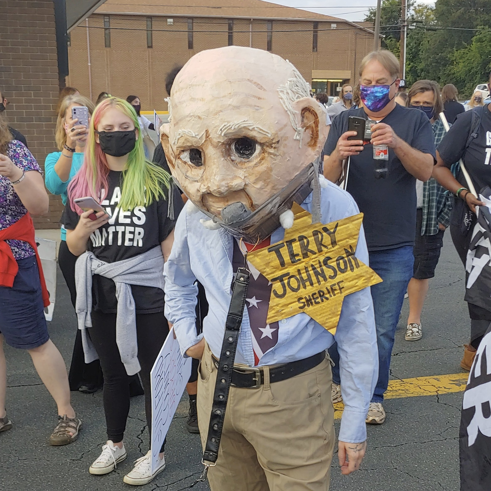
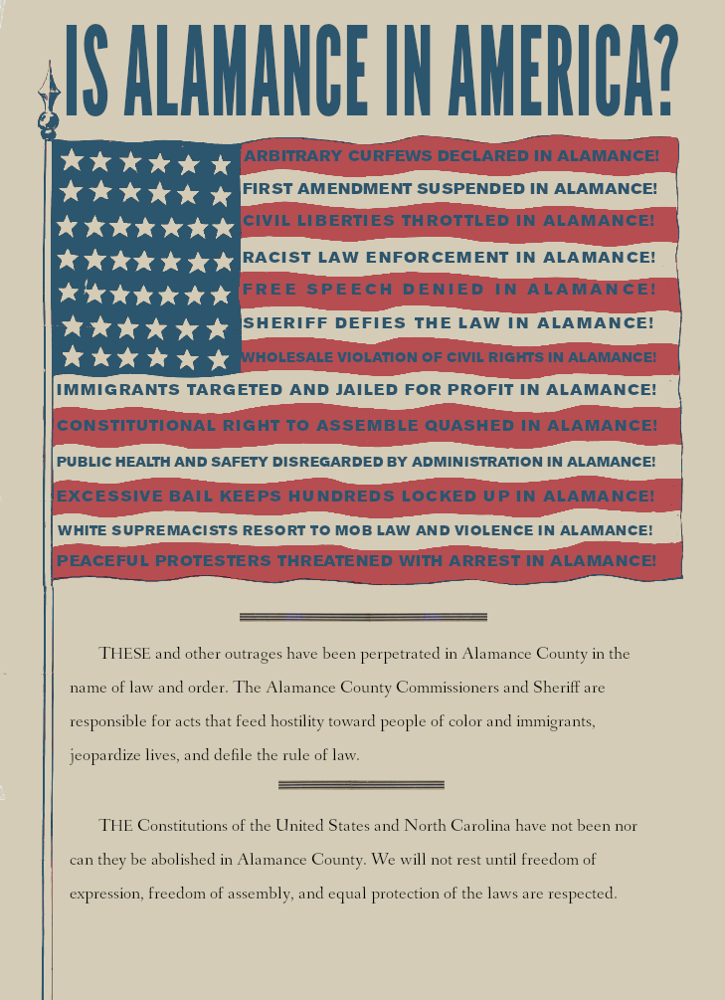
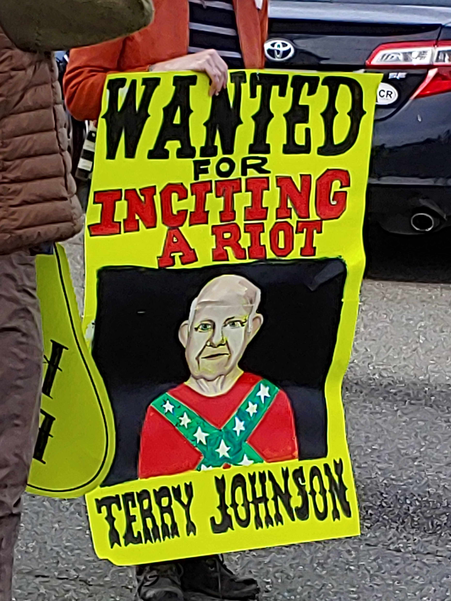
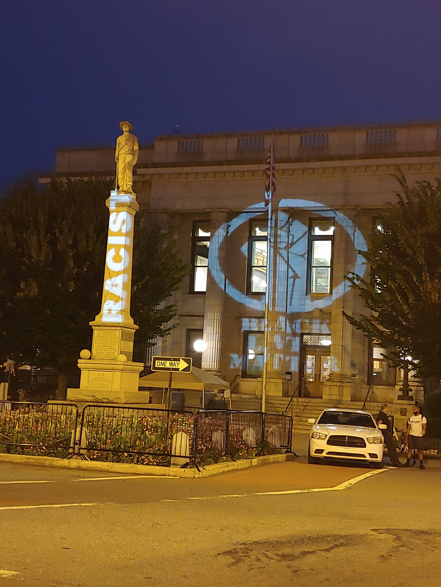
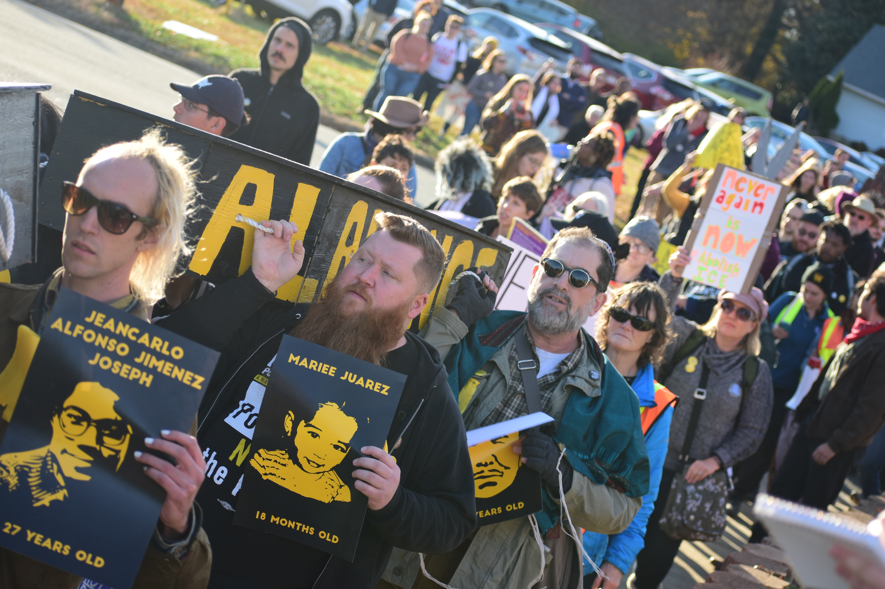
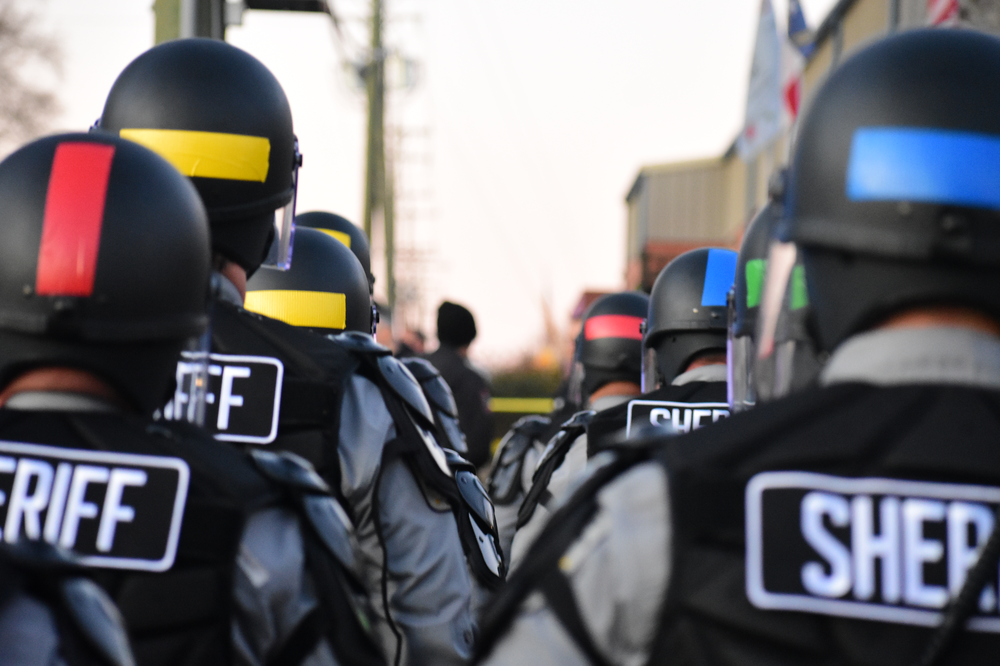
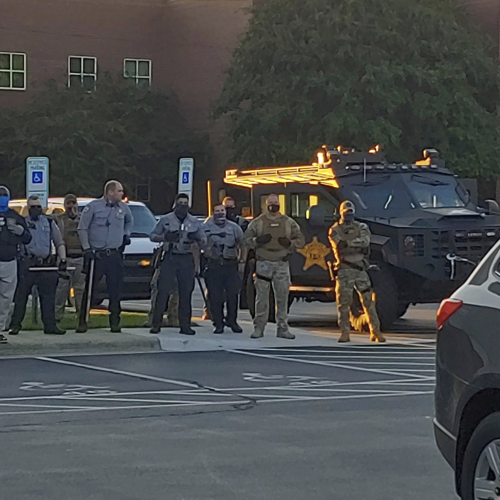

## Been on the Job Too Long (The Fall of Terry Johnson)

::: {.grid}

::: {.g-col-5}

::: {.player}



:::

::: {.nocaption}

 

 

 

:::

:::

::: {.g-col-7}

::: {.lyrics}

Well, it's twinkle, twinkle little star \
Along came Terry in his armored car \
Got a mean look right in his eye \
Gonna pepper spray somebody just to see them cry \
Been on the job too long

Well, a crowd was gathered outside the bar \
Along comes Terry with his shiny star \
Terry says, “People, you’re under arrest, \
Don’t you know here in Graham we don’t allow protests” \
Been on the job too long

Well Terry, Terry, Terry, you know you done wrong \
Coming down here with your riot gear on \
Terry, Terry, you know it ain’t fair \
Just because the people protest in the courthouse square \
Been on the job too long

Well, Sheriff Terry was a mean old man \
He looked at the crowd and he raised his hand \
Then his face went pale, he grabbed his chest \
And he fell to the ground for to take his rest \
Been on the job too long

High tailed carriages standing around \
Waiting to take Terry to the burying ground \
High tailed carriages, rubber tired hack \
Well, they took him to the graveyard but they didn't bring him back \
Been on the job too long

When the people all heard that Terry was dead \
They gathered by the statue and they painted it red \
Cheering and singing and dancing in the street \
Made it shake so hard they knocked it off its feet \
Been on the job too long

Well, Terry, Terry, well you know you done wrong \
Coming down here with your riot gear on \
Terry, Terry, you know it ain’t fair \
And now you're lying dead in the courthouse square \
Been on the job too long

:::

:::

:::